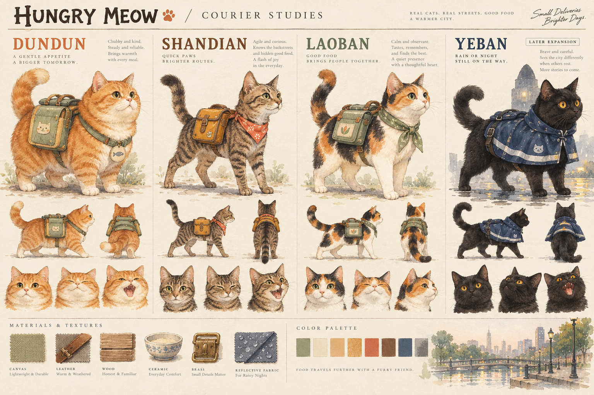
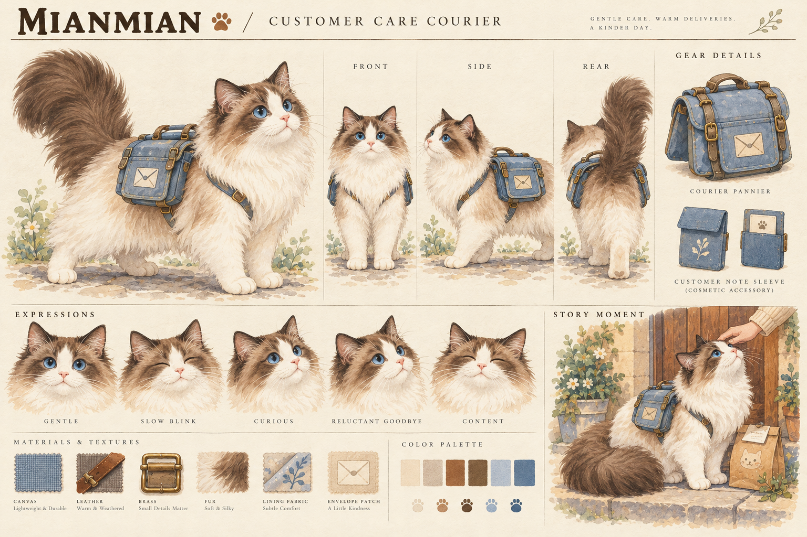
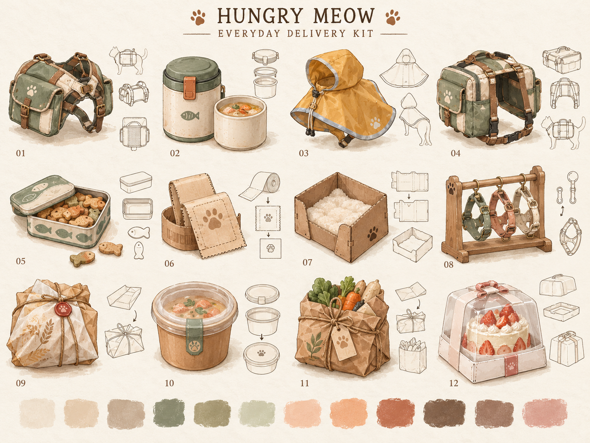
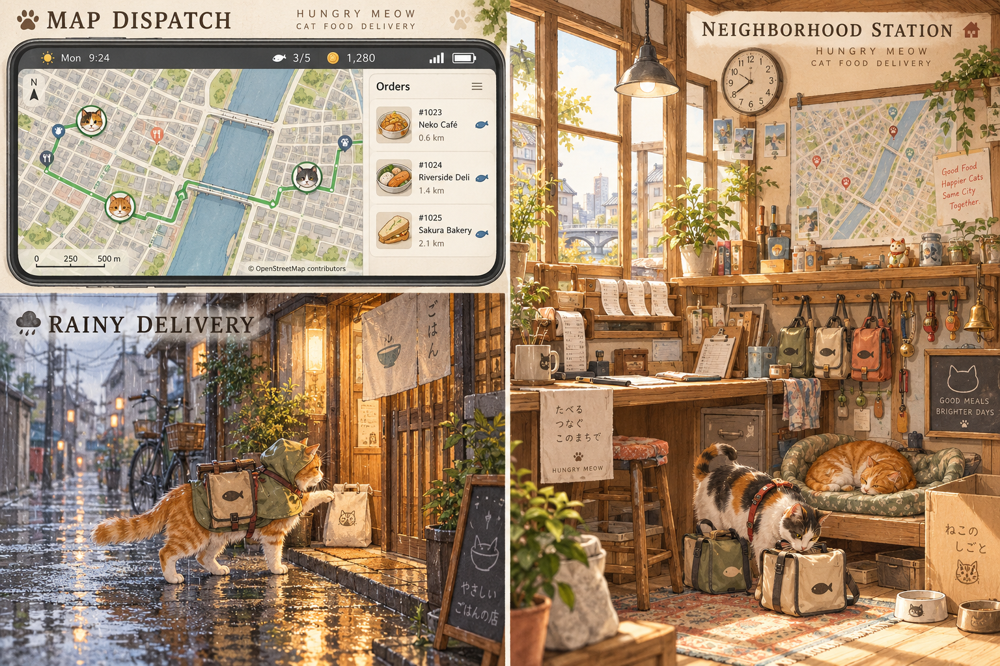

# 饿了喵 · Hungry Meow

在真实城市地图上，经营一家由小猫负责配送的外卖站。玩家认真规划路线，小猫认真制造意外。

## 文档

- [产品需求文档 PRD v0.3](docs/PRD-v0.3.md)：玩法、订单、猫咪、事件、经济、界面、技术与验收标准。
- [美术方向与资源清单](docs/美术资源清单-v0.3.md)：日式治愈风规范、角色、道具、场景、生产规格。
- [美术资源清单 CSV](docs/美术资源清单-v0.3.csv)：可下载到表格软件进行拆单与估算。
- [原始游戏创意方案 v0.1](docs/游戏创意方案-v0.1.md)：原始上传文档，保留用于追溯。

## 概念图

图片均为原尺寸 PNG，可点击打开原文件。

### 角色：猫咪配送员

初始角色为吨吨、闪电、老板；布偶猫绵绵在熟客故事开启后加入，首版共四只。夜班为后续扩展角色。下图是原角色探索板，绵绵见独立设定图。

### 新角色：布偶猫「绵绵」

客户关怀型配送员：擅长与需要耐心的顾客交接，送达后可选择多陪伴一会儿。奶油白与可可棕毛色、蓝眼睛、雾蓝色配送包。

### 道具：配送装备与生活物件

12 类道具：保温包、密封罐、雨披、大容量包、零食盒、票据、纸箱窝、装备架、面包包裹、汤碗、杂货袋与蛋糕箱。

### 场景：地图调度、雨天配送与配送站

## 使用说明

本仓库当前为设计资料，不含可运行的游戏实现。PRD 中的数值、平台和技术选择为待验证建议。

概念图由 AI 生成，用于美术方向讨论；并非分层生产稿。图中地图为示意，正式产品需接入合适的真实地图数据、保留署名并确认授权；图内英文与伪文字需在生产阶段替换。
