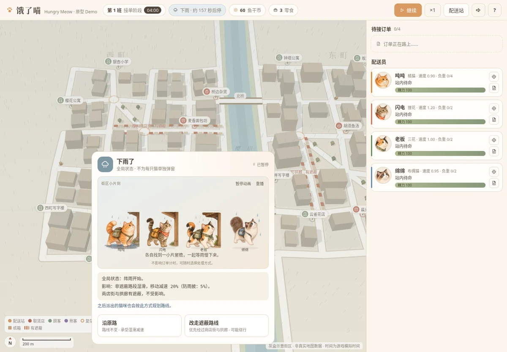
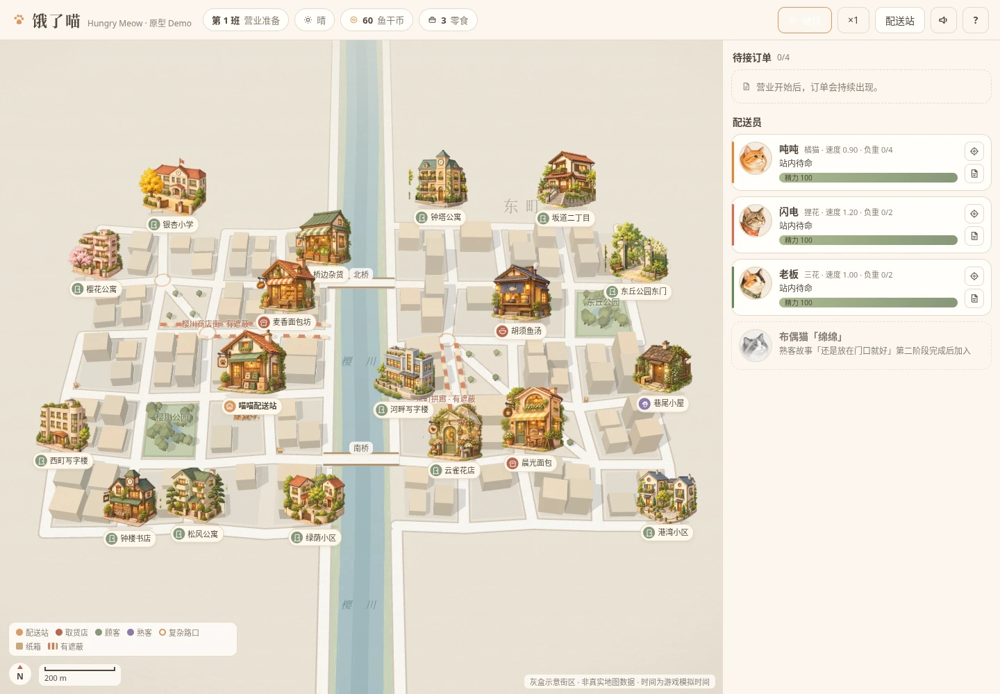

# 饿了喵 · Three.js 原型 Demo

基于 `docs/PRD-v0.3.md` 的 P0 范围制作的可玩原型：真实地图配送调度 × 猫咪性格 × 轻经营。
地图使用**腾讯位置服务 JavaScript API GL**，猫咪与道具通过 `GLCustomLayer` 用 three.js 绘制在同一 GL 上下文中。

参赛材料：[参赛材料](docs/参赛材料.md) · [投递版（可直接复制）](docs/参赛材料-投递版.md)

在线试玩（内网）：https://t48m3iza-omhxljpnp-devc.preview.with.woa.com/

## 运行

需要 Node.js 20.19+ 或 22.12+，建议使用较新的 Node.js 22 LTS。

```bash
cd demo
cp .env.example .env.local   # 首次运行：填入腾讯地图 Key 与营业区域
npm install
npm run dev                  # 打开 http://localhost:5173
npm run build                # 产物输出到 dist/
```

### 腾讯地图配置（`.env.local`，已在 .gitignore 中，不要提交）

| 变量 | 说明 |
| --- | --- |
| `VITE_TMAP_KEY` | 腾讯位置服务 Key。需在[控制台](https://lbs.qq.com/dev/console/key/manage)勾选 **WebServiceAPI**，并把 `localhost` 加入域名白名单；不要开启签名校验（SK） |
| `VITE_AREA_SW` / `VITE_AREA_NE` | 营业区域左下角 / 右上角，格式 `经度,纬度`，建议 1—2 km² |

修改后需重启 `npm run dev`。

### 地图模式（按优先级自动降级，失败可重试）

| 优先级 | 模式 | 条件 | 底图 | 路网 |
| --- | --- | --- | --- | --- |
| 1 | 腾讯真实街区 | 有 Key 且 WebServiceAPI 可用 | 腾讯地图 | 由「步行路线规划」结果合并而成的真实步行路网；真实 POI 仅作位置锚点，店名与顾客名为虚构 |
| 2 | **真实路网（OpenStreetMap）** | 有 Key，底图可加载即可；**不消耗 WebServiceAPI 配额** | 腾讯地图 | 由 OSM 道路中心线构建，经 WGS-84 → GCJ-02 转换后与腾讯底图对齐，猫咪沿真实街道行走；地点按真实功能属性放置与命名 |
| 3 | 腾讯底图 + 示意路网 | 真实路网数据也不可用 | 腾讯地图 | 区域内按真实米制生成的示意街网（地图上以灰色细线标出），保留主干道 + 两处过街点的瓶颈结构；**与底图道路不重合**，仅作兜底 |
| 4 | 灰盒街区 | 未配置 Key，或底图脚本也加载失败 | Three.js 灰盒 | 虚构街区（樱川 + 两座桥） |

- 模式 2 默认读取随项目发布的 `public/road-network.json`（当前区域 720 节点 / 955 边，约 44 KB），**运行时零网络依赖**，每次启动结果一致；该文件缺失时才回退到在线抓取 Overpass（公共镜像限流严重，不保证可用）。
- 模式 1 首次构建约需 60 次 WebService 调用（并发 2、带间隔），成功后固化到 localStorage；调用失败（如配额用尽，接口返回 `status: 121`）会直接降级到模式 2。
- 加载失败时页面会给出原因与「重试 / 腾讯底图 + 示意路网 / 灰盒街区」三个选项；「重试」会清空本地缓存并重新构建。
- 页面底部始终标注当前数据来源。

### 重新烘焙真实路网

换营业区域后需要重新生成 `public/road-network.json`：

```bash
# 1. 打印当前区域对应的 WGS-84 查询范围
node tools/bake-road-network.mjs --bbox

# 2. 用上一步的范围在 https://overpass-turbo.eu 查询并导出原始 JSON
#    （公共镜像限流频繁，用浏览器导出比命令行可靠）

# 3. 另取一份功能属性数据（建筑/用地/公园/学校等），用于地点放置与命名
#    way["building"](bbox);way["landuse"](bbox);way["leisure"](bbox);
#    way["amenity"](bbox);node["amenity"](bbox);node["shop"](bbox);node["office"](bbox);
#    输出用 out center tags;（只要中心点和标签，体积小很多）

# 4. 离线构建
node tools/bake-road-network.mjs ~/Downloads/roads.json --poi ~/Downloads/poi.json

# 不改路网、只重算地点与命名（无需道路原始数据）
node tools/bake-road-network.mjs public/road-network.json --poi ~/Downloads/poi.json
```

脚本负责区域裁剪、等距抽稀（8 m）、路口聚类（16 m）、取最大连通分量，并把地点铺开到真实街道上。

两条范围约束需要注意：

- **路网**允许溢出营业区域最多 90 m（`ROAD_PAD_M`），边界上的道路才不会断得突兀；超过的节点会被丢弃后重取最大连通分量。
- **地点锚点**只在营业区域内缩到 86%（`ANCHOR_INSET`）的范围里采样。最远点采样本身偏好「离已选点最远」，不加这道约束就会把地点全推到路网最外围，跑出地图可视范围。

### 地点命名与真实功能属性

传了 `--poi` 时，脚本会统计每个路口周边 170 m 内的 OSM 标签，归成住宅 / 办公 / 公园绿地 / 学校 / 文化 / 商业 / 运动 / 餐饮八类，然后：

1. **按属性放置**：每个地点有期望类别（耐心顾客要住宅、银杏小学要学校、东丘公园东门要公园），稀缺类别优先占位，并保证相邻地点间距不小于 150 m（`MIN_GAP_M`）。
2. **按属性命名**：保留原有的日式治愈风词根，后缀跟随实际属性——「绿荫」在住宅区是*绿荫小区*，在绿地旁就是*绿荫绿地*；「钟塔」在写字楼区是*钟塔写字楼*，在住宅区是*钟塔公寓*。
3. 店铺后缀由 `goods` 固定（面包坊 / 鱼汤 / 杂货），只挑贴合的位置，不会改名。

**店名与顾客名始终虚构**（PRD v0.3 约定）。真实 POI 名只写入 `realName` 字段作调试记录，不在界面展示。烘焙时会打印对照表，`~` 标记表示该地点退到了次优属性。

不传 `--poi` 时退回纯分散采样，沿用 `src/places.js` 里的默认名；灰盒与示意路网模式也始终用默认名。

> 路网与功能属性数据来自 [OpenStreetMap](https://www.openstreetmap.org/copyright)，© OpenStreetMap 贡献者，依 ODbL 许可使用。

## 已实现内容

| 模块 | 内容 |
| --- | --- |
| 地图 | 腾讯地图底图（平移、缩放、比例尺、指北针）；真实街区的商业体周边视为雨棚路段、公园周边为观鸟点；地点标签、纸箱与复杂路口标记；灰盒模式保留河流与桥梁瓶颈 |
| 猫咪 | 吨吨、闪电、老板逐步开放；熟客故事第二阶段完成后加入布偶猫绵绵。日式治愈风 2.5D 水彩立绘 + 同源头像定位点（含故事中的猫妈妈与两只幼猫） |
| 订单 | 面包 / 鱼汤 / 杂货；最多 4 笔待接；未接不扣分；超时保留基础收入；可取消；「需要耐心」顾客标签 |
| 调度 | 选猫、选装备、最多两单拼送、取送顺序调整（阻止先送后取、超重）、推荐顺序、各单 ETA、精力预估、性格风险与对策、地图路线预览（返站路径单独虚线）；在途追加订单从当前路段续算 |
| 性格 | 吨吨鱼香分心（密封罐可阻止）；闪电复杂路口跑过头（沿真实路段冲出，转弯提醒）；老板讨厌拥挤取货点（+6 秒）；老板交接 7 秒；绵绵免除耐心顾客额外 15 秒、送达后可选「再陪一会儿」 |
| 事件 | 纸箱、观鸟、鱼香、顾客摸猫、下雨（全局，可改走遮蔽路线）；有预兆、有免费选项、60 秒冷却，自动暂停并展示对下一单的时间影响 |
| 成长 | 精力（行进消耗 / 站内恢复 / 不足时阻止出发）、信任（解锁性格记录）、街区熟悉度（西町/东町三级） |
| 经营 | 班次：准备 → 接单 4 分钟 → 收尾 ≤3 分钟 → 结算（双向评价、工作记录）；配送站三个升级点：休息窝、装备架、订单台 |
| 故事 | 「还是放在门口就好」三阶段，地图上逐步出现食碗、爪印、猫妈妈与幼猫 |
| 其他 | 新手引导、统一模拟时钟（暂停 / ×1-×3）、切到后台自动暂停、本地存档、轻量音效 |

## 日式治愈风美术更新

已替换四只配送员、猫妈妈及两只幼猫的形象，并加入配送站背景。完整资源及接入说明见 [美术素材清单](public/art/README.md)。角色档案可查看完整立绘。

- 7 张透明底角色立绘，分别配套头像与灰度锁定头像。
- 配送站采用独立背景和角色叠加，保留装备、家具、购买及升级状态。
- 地图使用始终朝向镜头的 2.5D 立绘，带轻量起伏和左右朝向；不再使用原低多边形猫咪网格。
- 角色不改变派单、寻路、成长和存档格式。腾讯地图仍需原有 Key 配置；素材不依赖外部图床。

### 接入效果预览

以下截图来自本地灰盒模式的浏览器验证，使用测试进度展示四只猫与已购买装备；正式存档与解锁规则不变。


[查看角色档案预览](docs/character-preview.webp)

### 本次验证

- `npm run build` 通过，22 张运行图片全部进入构建产物。
- Chromium 检查通过：四猫站内展示、购买刷新、四份角色档案、猫妈妈与两只幼猫、左右镜像、暂停、派单和 844px 横屏布局；无页面异常或素材请求失败。
- 腾讯模式与灰盒模式共用新的角色渲染入口；本次未配置腾讯地图 Key，未对真实地图 SDK 做端到端实测。

## 随机事件动画与背景音乐

新增观鸟、纸箱、鱼香、摸猫、安静陪伴、雨天六组表现。每只猫都有自己的动作关键帧和节奏，共 24 段动画资源；雨天展示已解锁猫咪的群像。原有事件概率和派单数值不变。

- 事件卡自动播放一遍短动画，可暂停、继续、重播；不影响订单计时，也不需要看完才能选择处理方式。
- 切到后台暂停动画；事件关闭时释放播放器。减少动态效果设置下默认展示首帧，可手动播放。
- 动画加载失败时仍可正常处理事件。
- 新增原创背景音乐 **《街角的慢时光》**：约 80 秒循环，柔和合成钢琴、拨弦与温暖长音。首次点击后播放，切后台暂停。
- 顶栏声音按钮打开「音乐与音效」设置，可分别开关背景音乐和操作音效、调整音乐音量；偏好保存在本机。

### 查看与试听

运行 `npm run dev` 后，打开 **http://localhost:5173/art/events/index.html**，可逐一播放四只猫的 24 段动画，并试听音乐（若 Vite 使用其他端口，请替换端口）。

- [事件动画清单与接入说明](public/art/events/README.md)
- [背景音乐文件](public/audio/slow-corner.mp3) · [原创编曲与生成说明](public/audio/README.md)
- [音乐设置预览](docs/audio-preview.webp)



### 本次动画与音频验证

构建通过；浏览器检查覆盖 24 组独立动作、角色匹配、群像、暂停／重播、事件销毁、配送时钟、后台恢复、减少动态效果、844×390 横屏操作、音乐播放、独立开关、音量持久化和快速静音恢复。另验证了素材加载失败不阻止事件处理、素材加载期间切后台后能正常恢复。测试在灰盒模式运行；腾讯地图沿用同一事件 UI 与音频模块。

## 地图渲染治愈化

底图配色与美术立绘的风格差，全部在渲染层解决，**不改动 `public/road-network.json` 等任何地图数据**：

- **底图要素裁剪**（`src/tmap/tworld.js`）：`baseMap.features` 保留 `base` / `building2d` / `label`，去掉 `point` 与 `building3d`。原生 POI 图标是冷色系且密度高，是画面最大的风格噪音源；街道名保留，街区感不丢。
- **画布滤镜**（`src/style.css`）：对 `#map canvas` 施加 `saturate(0.66) sepia(0.14) brightness(1.045) contrast(0.93)`，把高饱和绿、明蓝水体压成水彩调。
- **纸纹与晕影**：`#map::after` 用 SVG `feTurbulence` 程序化生成颗粒（`multiply` 混合，不引入二进制素材），`#map::before` 叠暖褐晕影。层级放在 998 / 999，低于 SDK 事件层（1000）、地点标签层（1001）与雨层（1002），所以标签、猫咪头像、HUD 始终清晰可读。
- **阴影暖化**：地点标记与猫咪头像的投影由纯黑改为暖褐 `rgba(104, 78, 52, ·)`。

调参入口收口在 `#map-wrap` 的 `--cozy-*` 变量；给 `#map-wrap` 加 `.plain` 可一键回到原始配色，便于对照排查。滤镜只在真实地图模式启用（`.cozy-tmap`），灰盒街区本身已是暖米色，仅叠纸纹与晕影。

### 本次渲染验证

对照截图确认：原生 POI 冷色噪音消失、绿意保留、水体转柔和淡蓝、17 个地点标签清晰；猫咪立绘用 `toneMapped: false` 的 Sprite，开关滤镜对照后层次完整且色调更融合；帧率 60.1 fps（关）对 60.2 fps（开），无性能损耗。另补齐了雨层、事件猫咪呼吸、提示条弹入的 `prefers-reduced-motion` 覆盖。

## POI 水彩插画更新

当前全部 **18 个游戏 POI** 已换成独立水彩建筑插画：配送站、四间取货店铺、住宅、学校、书店、公园入口、花店与巷尾小屋等。采用比真实比例更夸张的尺寸，灰盒与腾讯地图共用同一套资源。

- 图片随地图适度缩放，地点名称独立显示；相关订单地点、悬停与键盘聚焦会突出展示。
- 替代原圆点、立柱和配送站简易模型；实际锚点、道路、寻路和派单逻辑不变。
- [查看 18 张素材与接入说明](public/art/poi/README.md)。本地预览地址：**http://localhost:5173/art/poi/index.html**（端口以 Vite 输出为准）。
- 构建和灰盒浏览器交互检查通过；腾讯 DOM 投影路径通过地图适配器检查，实际 SDK 显示仍需在现有 Key 环境复核。



## 操作

- 拖动平移、滚轮缩放；点击右侧订单打开派单面板；点击猫咪头像定位。
- 空格：暂停 / 继续；Esc：关闭派单面板。
- 标题页可选择「跳过教学」，直接解锁三只初始猫与拼送。

## 目录

```
demo/
├── index.html
├── .env.example        腾讯地图配置模板
├── public/
│   └── road-network.json  预烘焙的真实路网（OSM，GCJ-02）
├── tools/
│   └── bake-road-network.mjs  OSM 原始数据 → 路网文件
└── src/
    ├── main.js         入口：选择地图模式、加载 / 失败重试、主循环
    ├── roadgraph.js    通用路网（寻路、米制度量、片区、纸箱/观鸟点）
    ├── places.js       地点注册表（配送站、店铺、顾客）
    ├── geo.js          营业区域与经纬度 ↔ 本地米坐标换算
    ├── graph.js        灰盒街区路网
    ├── world.js        灰盒模式 Three.js 渲染
    ├── tmap/
    │   ├── sdk.js        动态加载 JS API GL、限流、本地缓存
    │   ├── discover.js   POI 检索 → 地点锚点
    │   ├── roadGraph.js  步行路线 → 真实路网；路网固化与本地加载
    │   ├── osmRoads.js   OSM 道路中心线 → 真实路网；WGS-84 ↔ GCJ-02
    │   ├── gridGraph.js  示意路网（不消耗配额）
    │   └── tworld.js     腾讯地图渲染层（GLCustomLayer 猫咪、路线、标签、雨层）
    ├── eventAnimation.js 事件关键帧播放器（独立于配送时钟）
    ├── poiArt.js       独立 POI 插画、按钮与显示尺寸
    ├── catArt.js       运行美术素材地址
    ├── catModel.js     水彩角色 Sprite 与头像
    ├── game.js         玩法模拟
    ├── ui.js           界面
    ├── data.js         数值与文案（PRD 初始测试值）
    └── icons.js / audio.js / util.js / style.css
```

## 说明

- 真实地点只作为位置锚点，店名与顾客名均为虚构；时间为游戏模拟时间。
- 当前营业区域（亚运村 / 奥林匹克公园周边）没有河流，瓶颈来自真实主干道与过街点，没有伪造河流。
- 速度、期限、价格等数值取自 PRD 初始测试值并做了少量原型调整，尚未经过经济模拟。
