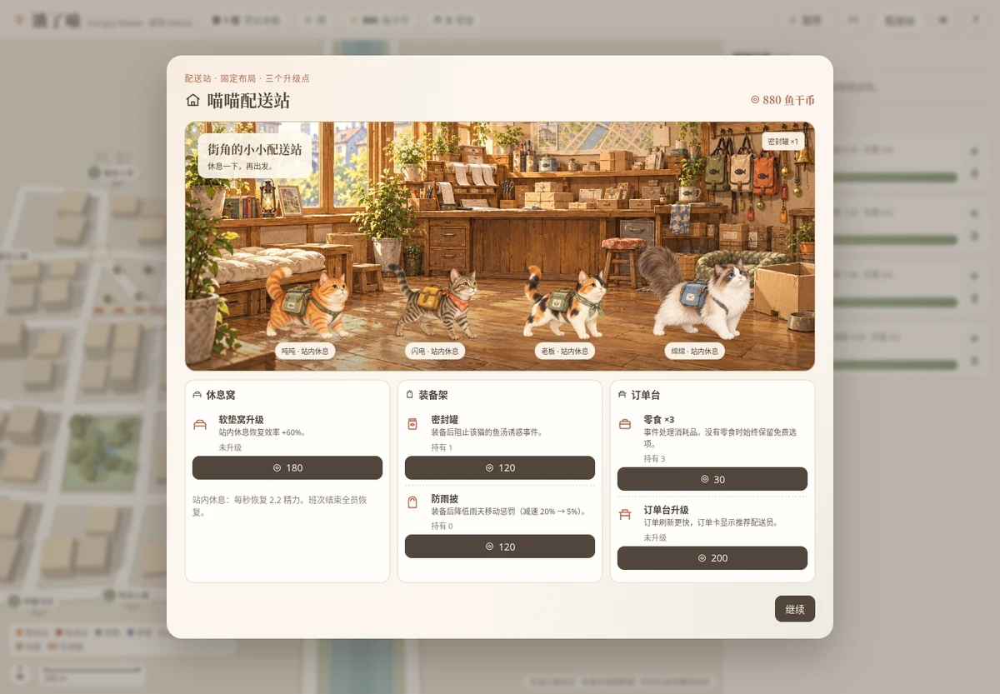

# 饿了喵 · Three.js 原型 Demo

基于 `docs/PRD-v0.3.md` 的 P0 范围制作的可玩原型：真实地图配送调度 × 猫咪性格 × 轻经营。
地图使用**腾讯位置服务 JavaScript API GL**，猫咪与道具通过 `GLCustomLayer` 用 three.js 绘制在同一 GL 上下文中。

## 运行

需要 Node.js 18+。

```bash
cd demo
cp .env.example .env.local   # 首次运行：填入腾讯地图 Key 与营业区域
npm install
npm run dev                  # 打开 http://localhost:5173
npm run build                # 产物输出到 dist/
```

### 腾讯地图配置（`.env.local`，已在 .gitignore 中，不要提交）

| 变量 | 说明 |
| --- | --- |
| `VITE_TMAP_KEY` | 腾讯位置服务 Key。需在[控制台](https://lbs.qq.com/dev/console/key/manage)勾选 **WebServiceAPI**，并把 `localhost` 加入域名白名单；不要开启签名校验（SK） |
| `VITE_AREA_SW` / `VITE_AREA_NE` | 营业区域左下角 / 右上角，格式 `经度,纬度`，建议 1—2 km² |

修改后需重启 `npm run dev`。

### 三种地图模式（自动选择，失败可重试）

| 模式 | 条件 | 底图 | 路网 |
| --- | --- | --- | --- |
| 腾讯真实街区 | 有 Key 且 WebServiceAPI 可用 | 腾讯地图 | 由「步行路线规划」结果合并而成的真实步行路网；真实 POI 仅作位置锚点，店名与顾客名为虚构 |
| 腾讯底图 + 示意路网 | 有 Key，但地点搜索 / 路线规划不可用（如配额用尽） | 腾讯地图 | 区域内按真实米制生成的示意街网（地图上以灰色细线标出），保留主干道 + 两处过街点的瓶颈结构 |
| 灰盒街区 | 未配置 Key，或底图脚本也加载失败 | Three.js 灰盒 | 虚构街区（樱川 + 两座桥） |

- 真实路网首次构建约需 60 次 WebService 调用（并发 2、带间隔），成功后**固化到 localStorage**，之后打开不再消耗配额。
- 加载失败时页面会给出原因（配额、白名单、未开启服务等）与「重试 / 腾讯底图 + 示意路网 / 灰盒街区」三个选项；「重试」会清空本地缓存并重新构建。
- 页面底部始终标注当前数据来源。

## 已实现内容

| 模块 | 内容 |
| --- | --- |
| 地图 | 腾讯地图底图（平移、缩放、比例尺、指北针）；真实街区的商业体周边视为雨棚路段、公园周边为观鸟点；地点标签、纸箱与复杂路口标记；灰盒模式保留河流与桥梁瓶颈 |
| 猫咪 | 吨吨、闪电、老板逐步开放；熟客故事第二阶段完成后加入布偶猫绵绵。日式治愈风 2.5D 水彩立绘 + 同源头像定位点（含故事中的猫妈妈与两只幼猫） |
| 订单 | 面包 / 鱼汤 / 杂货；最多 4 笔待接；未接不扣分；超时保留基础收入；可取消；「需要耐心」顾客标签 |
| 调度 | 选猫、选装备、最多两单拼送、取送顺序调整（阻止先送后取、超重）、推荐顺序、各单 ETA、精力预估、性格风险与对策、地图路线预览（返站路径单独虚线）；在途追加订单从当前路段续算 |
| 性格 | 吨吨鱼香分心（密封罐可阻止）；闪电复杂路口跑过头（沿真实路段冲出，转弯提醒）；老板讨厌拥挤取货点（+6 秒）；老板交接 7 秒；绵绵免除耐心顾客额外 15 秒、送达后可选「再陪一会儿」 |
| 事件 | 纸箱、观鸟、鱼香、顾客摸猫、下雨（全局，可改走遮蔽路线）；有预兆、有免费选项、60 秒冷却，自动暂停并展示对下一单的时间影响 |
| 成长 | 精力（行进消耗 / 站内恢复 / 不足时阻止出发）、信任（解锁性格记录）、街区熟悉度（西町/东町三级） |
| 经营 | 班次：准备 → 接单 4 分钟 → 收尾 ≤3 分钟 → 结算（双向评价、工作记录）；配送站三个升级点：休息窝、装备架、订单台 |
| 故事 | 「还是放在门口就好」三阶段，地图上逐步出现食碗、爪印、猫妈妈与幼猫 |
| 其他 | 新手引导、统一模拟时钟（暂停 / ×1-×3）、切到后台自动暂停、本地存档、轻量音效 |

## 日式治愈风美术更新

已替换四只配送员、猫妈妈及两只幼猫的形象，并加入配送站背景。完整资源及接入说明见 [美术素材清单](public/art/README.md)。角色档案可查看完整立绘。

- 7 张透明底角色立绘，分别配套头像与灰度锁定头像。
- 配送站采用独立背景和角色叠加，保留装备、家具、购买及升级状态。
- 地图使用始终朝向镜头的 2.5D 立绘，带轻量起伏和左右朝向；不再使用原低多边形猫咪网格。
- 角色不改变派单、寻路、成长和存档格式。腾讯地图仍需原有 Key 配置；素材不依赖外部图床。

### 接入效果预览

以下截图来自本地灰盒模式的浏览器验证，使用测试进度展示四只猫与已购买装备；正式存档与解锁规则不变。



[查看角色档案预览](docs/character-preview.webp)

### 本次验证

- `npm run build` 通过，22 张运行图片全部进入构建产物。
- Chromium 检查通过：四猫站内展示、购买刷新、四份角色档案、猫妈妈与两只幼猫、左右镜像、暂停、派单和 844px 横屏布局；无页面异常或素材请求失败。
- 腾讯模式与灰盒模式共用新的角色渲染入口；本次未配置腾讯地图 Key，未对真实地图 SDK 做端到端实测。

## 操作

- 拖动平移、滚轮缩放；点击右侧订单打开派单面板；点击猫咪头像定位。
- 空格：暂停 / 继续；Esc：关闭派单面板。
- 标题页可选择「跳过教学」，直接解锁三只初始猫与拼送。

## 目录

```
demo/
├── index.html
├── .env.example        腾讯地图配置模板
└── src/
    ├── main.js         入口：选择地图模式、加载 / 失败重试、主循环
    ├── roadgraph.js    通用路网（寻路、米制度量、片区、纸箱/观鸟点）
    ├── places.js       地点注册表（配送站、店铺、顾客）
    ├── geo.js          营业区域与经纬度 ↔ 本地米坐标换算
    ├── graph.js        灰盒街区路网
    ├── world.js        灰盒模式 Three.js 渲染
    ├── tmap/
    │   ├── sdk.js        动态加载 JS API GL、限流、本地缓存
    │   ├── discover.js   POI 检索 → 地点锚点
    │   ├── roadGraph.js  步行路线 → 真实路网；路网固化
    │   ├── gridGraph.js  示意路网（不消耗配额）
    │   └── tworld.js     腾讯地图渲染层（GLCustomLayer 猫咪、路线、标签、雨层）
    ├── catArt.js       运行美术素材地址
    ├── catModel.js     水彩角色 Sprite 与头像
    ├── game.js         玩法模拟
    ├── ui.js           界面
    ├── data.js         数值与文案（PRD 初始测试值）
    └── icons.js / audio.js / util.js / style.css
```

## 说明

- 真实地点只作为位置锚点，店名与顾客名均为虚构；时间为游戏模拟时间。
- 当前营业区域（亚运村 / 奥林匹克公园周边）没有河流，瓶颈来自真实主干道与过街点，没有伪造河流。
- 速度、期限、价格等数值取自 PRD 初始测试值并做了少量原型调整，尚未经过经济模拟。
