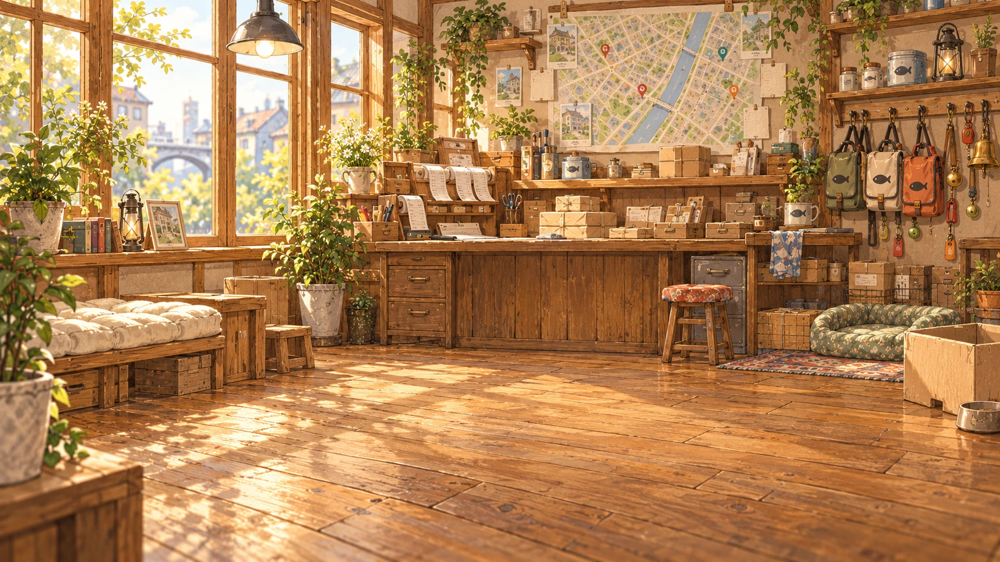

# Demo 日式治愈风美术素材

生成与接入日期：2026-10-19。参考仓库内角色、绵绵与配送站概念设定，采用水彩／水粉质感、暖褐细线、低饱和自然色。

## 角色清单

| ID | 角色 | 识别特征 | 完整立绘 |
| --- | --- | --- | --- |
| dundun | 吨吨 | 圆润橘猫，绿色配送包 | [WebP](cats/dundun.webp) |
| shandian | 闪电 | 修长狸花，赭黄包、珊瑚色领巾 | [WebP](cats/shandian.webp) |
| laoban | 老板 | 黑橘白三花，绿色包与整齐方巾 | [WebP](cats/laoban.webp) |
| mianmian | 绵绵 | 海豹双色布偶，蓝眼睛、雾蓝包 | [WebP](cats/mianmian.webp) |
| mom | 猫妈妈 | 灰白花纹，无配送装备 | [WebP](cats/mom.webp) |
| kitten-gray | 灰色幼猫 | 灰狸花，小体形，无装备 | [WebP](cats/kitten-gray.webp) |
| kitten-orange | 橘色幼猫 | 橘色条纹，小体形，无装备 | [WebP](cats/kitten-orange.webp) |

每个角色提供透明底完整立绘、256×256 头像（`-avatar.webp`）、灰度锁定头像（`-locked.webp`）。头像从同一立绘裁切，保持身份一致。夜班尚未出现在本版 Demo，未增加该角色素材。

## 配送站背景

[配送站室内背景](station/interior.webp)：晨光、木质柜台、装备架、票据与休息角。背景不含角色；实际猫咪、拥有装备、纸箱窝与明信片状态由界面叠加。背景中的生活物件仅为场景装饰，装备持有量以面板及状态标签为准。

## 接入方式

- `src/catArt.js`：统一素材地址与比例，跟随 Vite `BASE_URL`，支持子目录部署。
- `src/catModel.js`：共享 Three.js Sprite 角色，兼容灰盒与腾讯自定义图层；脚掌锚点、左右镜像、行进起伏、待机呼吸、精力休息色调。
- 地图上的角色为 **2.5D 水彩立绘**，并非多视角 3D 网格或逐帧行走动画。转动镜头时始终保持可读。
- 功能装备以小徽标表示，避免用通用雨披网格遮挡角色立绘；派单、装备库存和天气规则沿用原逻辑。
- UI：头像、地图定位点、档案立绘、绵绵入职页、配送站角色与第三阶段猫妈妈故事均使用新素材。
- 图像为 AI 生成的美术素材，尚需按正式生产流程复核解剖、跨视图和动画一致性。`manifest.json` 记录生成图标识、原始尺寸和头像裁切区域；仓库提交的是优化后的 WebP 运行资源。
